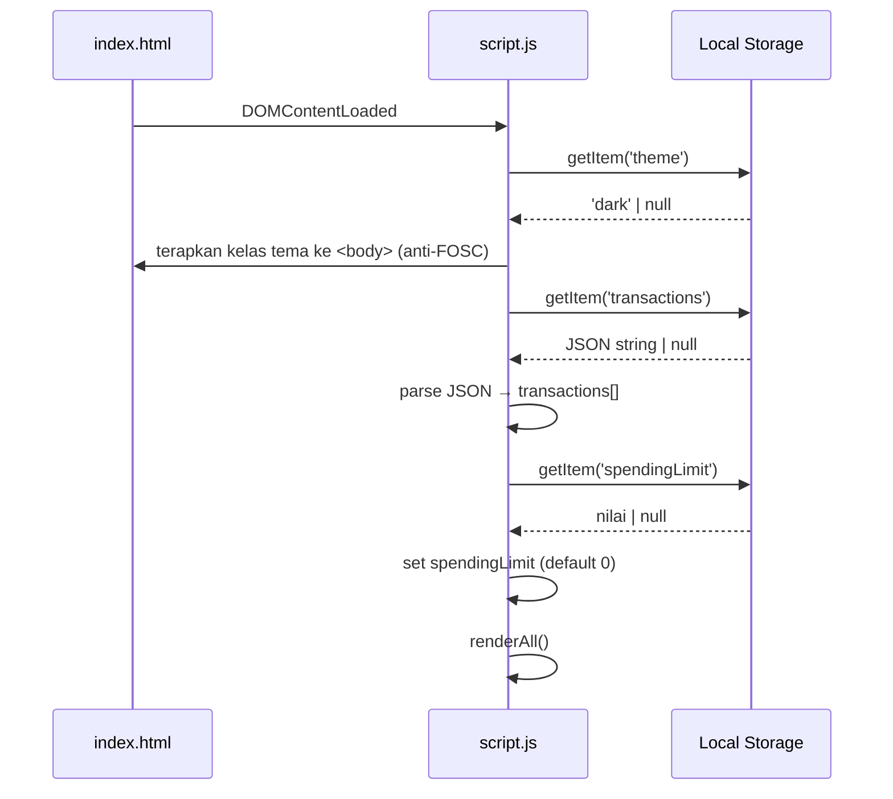

# Design Document

## Expense & Budget Visualizer

---

## Overview

Expense & Budget Visualizer adalah aplikasi web satu halaman (SPA) berbasis HTML, CSS, dan Vanilla JavaScript murni. Aplikasi ini memungkinkan pengguna mencatat, melihat, dan memvisualisasikan pengeluaran pribadi secara real-time tanpa memerlukan backend maupun build tool.

**Prinsip arsitektur:**
- **Stateful module tunggal** — satu file `js/script.js` mengelola seluruh state aplikasi dalam memori (array transaksi, spending limit, preferensi tema).
- **Single Source of Truth** — Local Storage adalah satu-satunya tempat persistensi; state di memori selalu disinkronkan sebelum UI diperbarui.
- **Re-render penuh pada perubahan state** — setiap perubahan state (tambah/hapus transaksi, ubah sorting, toggle dark mode) memanggil fungsi `renderAll()` yang memperbarui semua komponen secara konsisten.
- **Tidak ada dependensi runtime** — kecuali Chart.js yang dimuat via CDN untuk diagram lingkaran.

---

## Architecture

### Struktur File

```
expense-budget-visualizer/
├── index.html          # Markup HTML, memuat Chart.js via CDN dan script.js
├── css/
│   └── style.css       # Seluruh styling: variabel tema, layout responsif, komponen
└── js/
    └── script.js       # Seluruh logika aplikasi: state, event handler, render, utils
```

### Alur Data dan Hubungan Antar Komponen

```mermaid
flowchart TD
    LS[(Local Storage)] -->|loadAll| STATE
    STATE[State In-Memory\ntransactions[]\nspendingLimit\nsortCriteria\ntheme] -->|renderAll| UI

    UI --> TOTAL[Total Pengeluaran]
    UI --> FORM[Form Input]
    UI --> LIST[Daftar Transaksi]
    UI --> CHART[Pie Chart Chart.js]
    UI --> LIMIT[Spending Limit Input]
    UI --> TOGGLE[Dark Mode Toggle]

    FORM -->|submit event| VAL{Validator}
    VAL -->|valid| ADD[addTransaction]
    VAL -->|invalid| ERR[tampilkan inline error]
    ADD --> SAVE[saveToStorage] --> STATE
    LIST -->|click hapus| DEL[deleteTransaction]
    DEL --> SAVE
    LIMIT -->|submit| SAVELIMIT[saveSpendingLimit]
    SAVELIMIT --> SAVE
    TOGGLE -->|click| TOGTHEME[toggleTheme]
    TOGTHEME --> SAVE
```

### Urutan Inisialisasi Aplikasi



---

## Components and Interfaces

### Struktur HTML Utama

```
<body>
├── <header>                          # Judul aplikasi + tombol toggle dark mode
├── <main>
│   ├── <section id="summary">        # Total Pengeluaran + indikator spending limit
│   ├── <section id="form-section">   # Form Input Transaksi
│   ├── <section id="spending-limit"> # Input Spending Limit
│   └── <section id="content">        # Dua kolom: Daftar + Chart
│       ├── <div id="transaction-list-wrapper">
│       │   ├── <div id="sort-controls">   # Kontrol pengurutan
│       │   └── <ul id="transaction-list"> # Item transaksi
│       └── <div id="chart-wrapper">
│           ├── <canvas id="pie-chart">    # Chart.js
│           └── <p id="chart-empty-msg">  # Pesan saat kosong
└── <footer>
```

### Antarmuka Fungsi JavaScript Utama

| Fungsi | Deskripsi | Input | Output |
|---|---|---|---|
| `loadAll()` | Memuat semua data dari Local Storage | — | Memperbarui state global |
| `saveAll()` | Menyimpan semua data ke Local Storage | — | — |
| `renderAll()` | Memanggil semua fungsi render | — | Memperbarui DOM |
| `addTransaction(name, amount, category)` | Menambah transaksi baru | string, number, string | — |
| `deleteTransaction(id)` | Menghapus transaksi berdasarkan ID | string | — |
| `validateForm(name, amount, category)` | Memvalidasi input form | string, string, string | `{valid: boolean, errors: object}` |
| `sortTransactions(criteria)` | Mengurutkan transaksi | `'newest'\|'oldest'\|'amount-desc'\|'amount-asc'\|'category-az'` | Transaction[] |
| `formatRupiah(amount)` | Memformat angka ke format Rupiah | number | string |
| `computeTotal(transactions)` | Menghitung total pengeluaran | Transaction[] | number |
| `checkSpendingLimit(total, limit)` | Menentukan status spending limit | number, number | `'normal'\|'warning'\|'exceeded'` |
| `renderTransactionList(transactions)` | Merender daftar transaksi | Transaction[] | — |
| `renderSummary(total, status)` | Merender total dan status limit | number, string | — |
| `renderChart(transactions)` | Membuat/memperbarui Pie Chart | Transaction[] | — |
| `toggleTheme()` | Beralih light/dark mode | — | — |
| `applyTheme(theme)` | Menerapkan tema ke DOM | `'light'\|'dark'` | — |

---

## Data Models

### Model Transaksi

```javascript
// Skema satu objek Transaction
{
  id: string,         // UUID unik: crypto.randomUUID() atau Date.now().toString()
  name: string,       // Nama transaksi, 1–100 karakter
  amount: number,     // Nominal dalam Rupiah, integer 1–999_999_999
  category: string,   // 'Food' | 'Transport' | 'Fun'
  timestamp: number   // Unix timestamp saat pencatatan (Date.now())
}
```

### Skema Local Storage

| Key | Tipe Value | Contoh Value | Deskripsi |
|---|---|---|---|
| `transactions` | JSON string | `'[{"id":"abc","name":"Makan siang","amount":25000,"category":"Food","timestamp":1700000000}]'` | Array seluruh transaksi |
| `spendingLimit` | JSON string | `'500000'` | Nilai spending limit sebagai angka; `null` atau tidak ada = 0 (tidak aktif) |
| `theme` | JSON string | `'"dark"'` | Preferensi tema: `"light"` atau `"dark"` |

### State Global In-Memory

```javascript
// Variabel module-level di script.js
let transactions = [];      // Transaction[] — sumber kebenaran saat runtime
let spendingLimit = 0;      // number — 0 berarti tidak aktif
let currentSort = 'newest'; // string — kriteria pengurutan aktif
let chartInstance = null;   // Chart | null — instance Chart.js aktif
```

### Kategori Default

```javascript
const DEFAULT_CATEGORIES = ['Food', 'Transport', 'Fun'];
```

---

## Correctness Properties

*A property is a characteristic or behavior that should hold true across all valid executions of a system — essentially, a formal statement about what the system should do. Properties serve as the bridge between human-readable specifications and machine-verifiable correctness guarantees.*

### Property 1: Validasi menerima semua input valid dan menolak semua input tidak valid

*Untuk setiap* kombinasi input form, `validateForm(name, amount, category)` mengembalikan `valid: true` jika dan hanya jika nama tidak kosong/spasi (dan ≤100 karakter), nominal adalah integer antara 1 dan 999.999.999 (inklusif), dan kategori adalah salah satu dari nilai default yang valid. Untuk semua input lainnya, fungsi mengembalikan `valid: false`.

**Validates: Requirements 1.3, 1.4**

---

### Property 2: Round-trip penyimpanan transaksi

*Untuk setiap* transaksi valid yang ditambahkan melalui `addTransaction()`, setelah `saveAll()` dipanggil, memanggil `loadAll()` di lingkungan baru harus menghasilkan array transaksi yang mengandung transaksi tersebut dengan semua field yang identik (id, name, amount, category, timestamp).

**Validates: Requirements 1.5, 5.1, 5.2**

---

### Property 3: Penambahan transaksi meningkatkan total secara presisi

*Untuk setiap* array transaksi yang ada dan setiap transaksi baru yang valid, nilai `computeTotal()` setelah penambahan harus sama persis dengan `computeTotal()` sebelum penambahan ditambah dengan `amount` transaksi baru.

**Validates: Requirements 3.3**

---

### Property 4: Penghapusan transaksi mengurangi total secara presisi

*Untuk setiap* array transaksi yang ada dan setiap transaksi yang dipilih untuk dihapus, nilai `computeTotal()` setelah penghapusan harus sama persis dengan `computeTotal()` sebelum penghapusan dikurangi `amount` transaksi yang dihapus. Transaksi yang dihapus tidak boleh lagi ada dalam array.

**Validates: Requirements 2.5, 3.4**

---

### Property 5: Format Rupiah konsisten untuk semua nilai nominal

*Untuk setiap* integer non-negatif `n`, `formatRupiah(n)` harus selalu menghasilkan string yang: (a) diawali dengan "Rp", (b) menggunakan titik sebagai pemisah ribuan, (c) tidak mengandung angka desimal, dan (d) nilai numerik yang dapat dibaca dari string tersebut sama dengan `n`.

**Validates: Requirements 2.1, 3.1, 4.5, 9.4**

---

### Property 6: Klasifikasi status spending limit

*Untuk setiap* pasangan nilai `(total, limit)` di mana `limit > 0`, fungsi `checkSpendingLimit(total, limit)` harus mengembalikan:
- `'normal'` jika `total < 0.8 * limit`
- `'warning'` jika `0.8 * limit <= total <= limit`
- `'exceeded'` jika `total > limit`

Ketika `limit === 0`, fungsi harus selalu mengembalikan `'normal'`.

**Validates: Requirements 7.4, 7.5, 7.6**

---

### Property 7: Kriteria pengurutan terpenuhi untuk semua array transaksi

*Untuk setiap* array transaksi dengan panjang ≥ 2 dan setiap kriteria pengurutan yang valid, fungsi `sortTransactions(criteria)` harus menghasilkan array yang memenuhi kondisi urutan berikut untuk setiap pasangan elemen berurutan `(a, b)`:
- `'newest'`: `a.timestamp >= b.timestamp`
- `'oldest'`: `a.timestamp <= b.timestamp`
- `'amount-desc'`: `a.amount >= b.amount`
- `'amount-asc'`: `a.amount <= b.amount`
- `'category-az'`: `a.category.localeCompare(b.category) <= 0`

**Validates: Requirements 6.3, 6.4, 6.5**

---

### Property 8: Kriteria pengurutan dipertahankan setelah tambah/hapus

*Untuk setiap* state pengurutan aktif (`currentSort`), setelah operasi tambah atau hapus transaksi apapun, daftar yang dirender harus masih memenuhi kondisi urutan dari `currentSort` yang sama (seperti didefinisikan di Property 7).

**Validates: Requirements 6.4, 6.5**

---

### Property 9: Toggle tema adalah operasi round-trip

*Untuk setiap* state tema saat ini (`'light'` atau `'dark'`), memanggil `toggleTheme()` dua kali berturut-turut harus menghasilkan state tema yang identik dengan state awal, baik di memori maupun di Local Storage dan di kelas yang diterapkan pada `<body>`.

**Validates: Requirements 8.3, 8.4**

---

### Property 10: Data chart mencerminkan kategori yang ada dalam transaksi

*Untuk setiap* array transaksi, data yang diteruskan ke Chart.js harus memiliki label yang persis sama dengan himpunan kategori unik yang terdapat dalam array transaksi tersebut (tidak lebih, tidak kurang). Jika sebuah kategori tidak memiliki transaksi, kategori tersebut tidak boleh muncul dalam data chart.

**Validates: Requirements 4.1, 4.4**

---

### Property 11: Round-trip persistensi spending limit

*Untuk setiap* nilai spending limit valid `v` (integer 1–999.999.999), setelah disimpan via `saveAll()` dan dimuat kembali via `loadAll()`, nilai yang dimuat harus sama persis dengan `v`. Untuk spending limit yang dihapus/dikosongkan, `loadAll()` harus menghasilkan nilai 0.

**Validates: Requirements 7.2, 7.7**

---

## Error Handling

### Strategi Penanganan Error

| Skenario Error | Strategi | Pesan ke Pengguna |
|---|---|---|
| Local Storage tidak tersedia | `try/catch` pada setiap operasi LS; fallback ke state in-memory saja | "Penyimpanan tidak tersedia. Data tidak akan tersimpan." (banner atas) |
| Local Storage penuh (`QuotaExceededError`) | Tangkap error pada `saveAll()`; batalkan operasi dan rollback state | "Penyimpanan penuh. Hapus beberapa transaksi untuk melanjutkan." |
| Data JSON rusak di Local Storage | `try/catch` di `loadAll()`; gunakan array kosong sebagai fallback | Tidak ada pesan error teknis; aplikasi mulai bersih |
| Chart.js gagal dimuat via CDN | `try/catch` di `renderChart()`; sembunyikan area chart | "Diagram tidak dapat dimuat. Periksa koneksi internet." |
| Input melebihi batas validasi | Tampilkan pesan inline per field; jangan simpan | Pesan inline di bawah field (lihat Requirement 1.4) |

### Validasi Input (Validator)

```javascript
function validateForm(name, amount, category) {
  const errors = {};

  // Validasi nama
  const trimmedName = name.trim();
  if (!trimmedName) {
    errors.name = 'Nama transaksi tidak boleh kosong.';
  } else if (trimmedName.length > 100) {
    errors.name = 'Nama transaksi maksimal 100 karakter.';
  }

  // Validasi nominal
  const parsedAmount = Number(amount);
  if (!amount || isNaN(parsedAmount) || !Number.isInteger(parsedAmount)) {
    errors.amount = 'Nominal harus berupa angka bulat.';
  } else if (parsedAmount < 1 || parsedAmount > 999_999_999) {
    errors.amount = 'Nominal harus antara Rp 1 dan Rp 999.999.999.';
  }

  // Validasi kategori
  if (!category || !DEFAULT_CATEGORIES.includes(category)) {
    errors.category = 'Pilih salah satu kategori.';
  }

  return { valid: Object.keys(errors).length === 0, errors };
}
```

### Rollback State

Setiap fungsi mutasi (`addTransaction`, `deleteTransaction`, `saveSpendingLimit`) mengikuti pola berikut:

```
1. Buat salinan state saat ini (snapshot)
2. Terapkan perubahan ke state in-memory
3. Coba saveAll() ke Local Storage
4. Jika berhasil: renderAll()
5. Jika gagal: kembalikan state ke snapshot, tampilkan pesan error
```

---

## Testing Strategy

### Pendekatan Pengujian Ganda

Pengujian menggunakan dua pendekatan komplementer:

1. **Unit test berbasis contoh** — untuk perilaku spesifik, kondisi edge case, dan pemeriksaan integrasi komponen.
2. **Property-based test** — untuk properti universal yang harus berlaku di seluruh ruang input (lihat bagian Correctness Properties).

### Library Property-Based Testing

Gunakan **[fast-check](https://github.com/dubzzz/fast-check)** (JavaScript) karena:
- Mendukung Vanilla JavaScript tanpa framework
- Generator bawaan yang kaya (integer, string, array, record)
- Output shrinking otomatis untuk menemukan counterexample minimal
- Dapat dijalankan dengan Node.js tanpa setup kompleks

Konfigurasi minimum 100 iterasi per property test.

### Implementasi Property Tests

Setiap property test harus diberi tag komentar dengan format:
`// Feature: expense-budget-visualizer, Property N: <teks properti>`

Contoh implementasi:

```javascript
// Feature: expense-budget-visualizer, Property 5: Format Rupiah konsisten
test('formatRupiah menghasilkan format yang benar untuk semua integer non-negatif', () => {
  fc.assert(
    fc.property(fc.integer({ min: 0, max: 999_999_999 }), (n) => {
      const result = formatRupiah(n);
      expect(result).toMatch(/^Rp/);
      expect(result).not.toMatch(/[.,]\d{2}$/); // tidak ada desimal
      // Verifikasi nilai numerik yang dapat dibaca sama dengan n
      const numeric = parseInt(result.replace(/\D/g, ''), 10);
      expect(numeric).toBe(n);
    }),
    { numRuns: 100 }
  );
});
```

```javascript
// Feature: expense-budget-visualizer, Property 6: Klasifikasi status spending limit
test('checkSpendingLimit mengklasifikasikan status dengan benar', () => {
  fc.assert(
    fc.property(
      fc.integer({ min: 1, max: 999_999_999 }),  // limit
      fc.integer({ min: 0, max: 1_200_000_000 }), // total
      (limit, total) => {
        const status = checkSpendingLimit(total, limit);
        if (total < 0.8 * limit) expect(status).toBe('normal');
        else if (total <= limit) expect(status).toBe('warning');
        else expect(status).toBe('exceeded');
      }
    ),
    { numRuns: 100 }
  );
});
```

```javascript
// Feature: expense-budget-visualizer, Property 7: Kriteria pengurutan terpenuhi
test('sortTransactions memenuhi kondisi urutan untuk semua criteria valid', () => {
  const criteriaChecks = {
    'amount-desc': (a, b) => a.amount >= b.amount,
    'amount-asc':  (a, b) => a.amount <= b.amount,
    'category-az': (a, b) => a.category.localeCompare(b.category) <= 0,
  };

  Object.entries(criteriaChecks).forEach(([criteria, check]) => {
    fc.assert(
      fc.property(fc.array(transactionArbitrary(), { minLength: 2 }), (txs) => {
        const sorted = sortTransactions(txs, criteria);
        for (let i = 0; i < sorted.length - 1; i++) {
          expect(check(sorted[i], sorted[i + 1])).toBe(true);
        }
      }),
      { numRuns: 100 }
    );
  });
});
```

### Unit Test Berbasis Contoh

| Area | Skenario yang Diuji |
|---|---|
| Validasi form | Nama kosong, nama 101 karakter, nominal 0, nominal negatif, nominal desimal, kategori kosong, semua valid |
| State kosong | Total menampilkan "Rp 0", daftar menampilkan pesan kosong, chart tersembunyi |
| Local Storage rusak | Aplikasi mulai dengan array kosong, tidak ada error teknis di UI |
| Spending limit dihapus | Semua peringatan hilang, kunci LS terhapus |
| Default tema | Light mode diterapkan saat tidak ada preferensi tersimpan |

### Desain untuk Ketestabilan

Agar logika bisnis dapat diuji secara terisolasi dari DOM dan Local Storage:

- **Fungsi murni diekspor** — `formatRupiah`, `computeTotal`, `checkSpendingLimit`, `sortTransactions`, `validateForm` tidak memiliki efek samping dan dapat diuji langsung.
- **Injeksi dependensi storage** — `loadAll(storage)` dan `saveAll(storage)` menerima objek storage sebagai parameter (default `window.localStorage`) sehingga dapat di-mock dalam pengujian.
- **Fungsi render dipisah** — `renderTransactionList`, `renderSummary`, `renderChart` menerima data sebagai parameter, bukan membaca dari state global langsung, sehingga dapat diuji dengan data buatan.

---

## CSS Design

### Variabel Tema (CSS Custom Properties)

```css
/* css/style.css */

:root {
  /* Light Mode (default) */
  --color-bg:         #f8f9fa;
  --color-surface:    #ffffff;
  --color-border:     #dee2e6;
  --color-text:       #212529;
  --color-text-muted: #6c757d;
  --color-primary:    #0d6efd;
  --color-danger:     #dc3545;
  --color-warning-bg: #fff3cd;
  --color-warning-text: #856404;
  --color-exceeded-bg:  #f8d7da;
  --color-exceeded-text: #842029;
  --color-shadow:     rgba(0, 0, 0, 0.08);
}

body.dark-mode {
  --color-bg:         #121212;
  --color-surface:    #1e1e1e;
  --color-border:     #333333;
  --color-text:       #e0e0e0;
  --color-text-muted: #9e9e9e;
  --color-primary:    #4dabf7;
  --color-danger:     #ff6b6b;
  --color-warning-bg: #332701;
  --color-warning-text: #ffd43b;
  --color-exceeded-bg:  #2c0b0e;
  --color-exceeded-text: #f1aeb5;
  --color-shadow:     rgba(0, 0, 0, 0.4);
}
```

### Breakpoint Responsif

```css
/* Layout dua kolom: Daftar Transaksi | Pie Chart */
#content {
  display: grid;
  grid-template-columns: 1fr 1fr;
  gap: 1.5rem;
}

/* Satu kolom pada layar mobile */
@media (max-width: 767px) {
  #content {
    grid-template-columns: 1fr;
  }
}
```

### Kelas Utilitas untuk Spending Limit

```css
/* Diterapkan secara dinamis ke elemen #summary oleh JavaScript */
#summary.status-warning {
  background-color: var(--color-warning-bg);
  color: var(--color-warning-text);
  border-left: 4px solid #ffc107;
}

#summary.status-exceeded {
  background-color: var(--color-exceeded-bg);
  color: var(--color-exceeded-text);
  border-left: 4px solid #dc3545;
}
```

---

## Chart.js Integration

### Versi dan Pemuatan

```html
<!-- index.html: muat Chart.js via CDN sebelum script.js -->
<script src="https://cdn.jsdelivr.net/npm/chart.js@4.4.0/dist/chart.umd.min.js"></script>
<script src="js/script.js" defer></script>
```

### Pembuatan Instance Chart

```javascript
function renderChart(transactions) {
  const canvas = document.getElementById('pie-chart');
  const emptyMsg = document.getElementById('chart-empty-msg');

  if (transactions.length === 0) {
    canvas.style.display = 'none';
    emptyMsg.style.display = 'block';
    // Hancurkan instance yang ada (jika ada)
    if (chartInstance) {
      chartInstance.destroy();
      chartInstance = null;
    }
    return;
  }

  canvas.style.display = 'block';
  emptyMsg.style.display = 'none';

  // Hitung total per kategori
  const categoryTotals = {};
  for (const tx of transactions) {
    categoryTotals[tx.category] = (categoryTotals[tx.category] || 0) + tx.amount;
  }

  const labels = Object.keys(categoryTotals);
  const data   = Object.values(categoryTotals);

  // Palet warna per kategori (konsisten)
  const CATEGORY_COLORS = {
    Food:      '#4dabf7',
    Transport: '#69db7c',
    Fun:       '#ffa94d',
  };
  const backgroundColors = labels.map(l => CATEGORY_COLORS[l] || '#adb5bd');

  if (chartInstance) {
    // Perbarui instance yang ada (lebih efisien daripada destroy+create)
    chartInstance.data.labels = labels;
    chartInstance.data.datasets[0].data   = data;
    chartInstance.data.datasets[0].backgroundColor = backgroundColors;
    chartInstance.update();
  } else {
    // Buat instance baru
    chartInstance = new Chart(canvas, {
      type: 'pie',
      data: {
        labels,
        datasets: [{
          data,
          backgroundColor: backgroundColors,
          borderWidth: 2,
          borderColor: 'var(--color-surface)',
        }],
      },
      options: {
        responsive: true,
        plugins: {
          legend: {
            position: 'bottom',
            labels: {
              // Tampilkan "Kategori: Rp X.XXX" di legenda
              generateLabels(chart) {
                return chart.data.labels.map((label, i) => ({
                  text: `${label}: ${formatRupiah(chart.data.datasets[0].data[i])}`,
                  fillStyle: chart.data.datasets[0].backgroundColor[i],
                  index: i,
                }));
              },
            },
          },
          tooltip: {
            callbacks: {
              label(ctx) {
                return ` ${ctx.label}: ${formatRupiah(ctx.raw)}`;
              },
            },
          },
        },
      },
    });
  }
}
```

### Strategi Update vs. Destroy/Recreate

Aplikasi menggunakan strategi **update-in-place** (`chartInstance.update()`) ketika instance sudah ada:
- Lebih efisien — tidak ada alokasi ulang Canvas context
- Animasi transisi bawaan Chart.js tetap berjalan dengan mulus
- Instance hanya dihancurkan (`chartInstance.destroy()`) saat transaksi terakhir dihapus (chart menjadi kosong)

---

## Logic Flows

### Alur Tambah Transaksi

```
1. Pengguna mengisi form dan klik "Simpan"
2. Ambil nilai: name, amount, category dari DOM
3. validateForm(name, amount, category)
   - Jika invalid: tampilkan pesan inline per field → BERHENTI
   - Jika valid: lanjut
4. Buat objek Transaction baru dengan id=crypto.randomUUID(), timestamp=Date.now()
5. Snapshot transactions[] saat ini
6. transactions.push(newTx)
7. saveAll() → try/catch
   - Jika QuotaExceededError: kembalikan ke snapshot, tampilkan banner error → BERHENTI
8. renderAll()
9. Reset form ke state awal
```

### Alur Hapus Transaksi

```
1. Pengguna klik tombol "Hapus" pada item daftar
2. Ambil id dari atribut data-id tombol
3. Snapshot transactions[] saat ini
4. transactions = transactions.filter(tx => tx.id !== id)
5. saveAll() → try/catch
   - Jika error: kembalikan ke snapshot, tampilkan banner error → BERHENTI
6. renderAll()
```

### Alur renderAll()

```javascript
function renderAll() {
  const sorted  = sortTransactions(transactions, currentSort);
  const total   = computeTotal(transactions);
  const status  = checkSpendingLimit(total, spendingLimit);

  renderSummary(total, status, spendingLimit);
  renderTransactionList(sorted, currentSort);
  renderChart(transactions);
  renderSpendingLimitInput(spendingLimit);
  updateThemeToggleButton();
}
```

### Alur Inisialisasi (Anti-FOSC)

Untuk mencegah Flash of Unstyled Content (FOSC), tema diterapkan **sebelum** DOMContentLoaded selesai:

```html
<!-- Ditempatkan di dalam <head> index.html, sebelum </head> -->
<script>
  // Inline script: jalankan sebelum render pertama
  (function() {
    try {
      const theme = JSON.parse(localStorage.getItem('theme'));
      if (theme === 'dark') document.body.classList.add('dark-mode');
    } catch (e) { /* abaikan */ }
  })();
</script>
```
